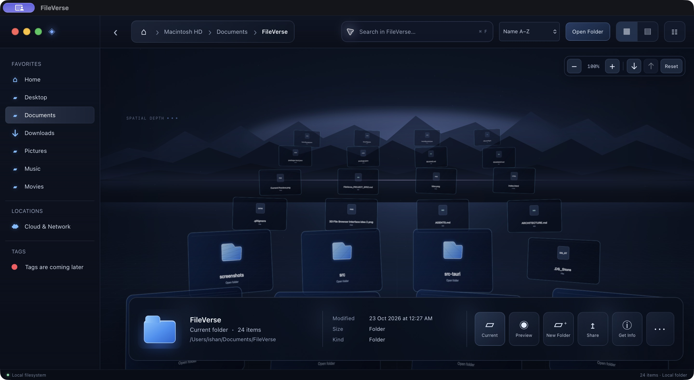
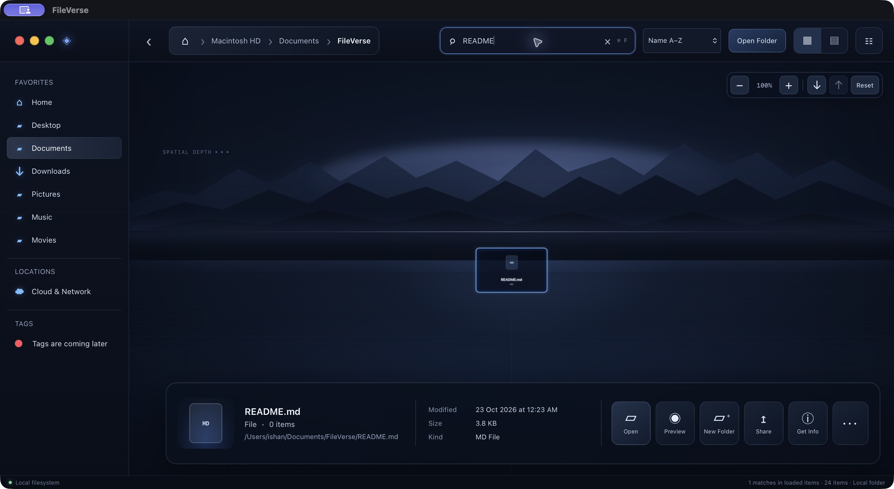
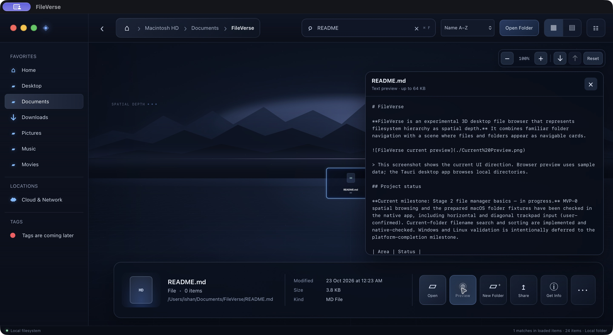

# FileVerse

**FileVerse is an experimental 3D desktop file browser that represents filesystem hierarchy as spatial depth.** It combines familiar folder navigation with a scene where files and folders appear as navigable cards.

## Download FileVerse

The current **v0.1.0 pre-release** is available for **macOS on Apple Silicon (arm64)**:

- [Download the macOS DMG](https://github.com/visitishan/FileVerse/releases/download/v0.1.0/FileVerse_0.1.0_aarch64.dmg)
- [View the release and its notes](https://github.com/visitishan/FileVerse/releases/tag/v0.1.0)

This is an experimental build and is not notarized by Apple, so macOS may show a warning when you first open it. Windows and Linux builds are not available yet.

### Spatial browsing



### Current-folder search



### Bounded text preview



These screenshots show the current native Tauri app. The browser preview uses sample data; the desktop app browses local directories.

## Project status

**Current milestone: Stage 3 safe local file operations — in progress.** MVP-0 spatial browsing and Stage 2 search, sorting, and bounded text preview have been checked in the macOS native app. Create Folder, Rename, and single-file Copy have passed native checks against disposable fixtures. Windows and Linux validation is intentionally deferred to the platform-completion milestone.

| Area | Status |
|---|---|
| Tauri + React/TypeScript + Three.js app shell | Implemented |
| Rust-backed local directory access and common sidebar locations | Implemented; startup, sidebar navigation, picker selection/cancel, and folder navigation reported working |
| Spatial cards, folder navigation, Back, and breadcrumbs | Implemented; manually verified |
| Zoom, centered orbit, and depth controls | Implemented; vertical scroll was checked in the native app moving through loaded layers, while horizontal scroll and drag orbit around the loaded stack center |
| macOS empty, special-name, large-folder, permission, symlink, and mouse-drag checks | Verified in the Tauri desktop app; 28 Rust tests pass |
| Selected-root boundary; horizontal/diagonal gesture checks | Verified; horizontal/diagonal gestures were user-confirmed in the [MVP-0 smoke checklist](./docs/MVP0_NATIVE_SMOKE_CHECKLIST.md) |
| Current-folder filename search | Implemented and native-checked for shortcut focus, matching results, and no-match state |
| Current-folder sorting | Implemented and native-checked for name, modified time, and size ordering |
| Bounded plain-text preview | Native-checked for the 64 KiB limit, unsupported types, invalid UTF-8, symlink rejection, and selected-root boundaries; details in the [Stage 2 checklist](./docs/STAGE2_NATIVE_CHECKLIST.md) |
| Create a folder | Implemented and native-verified with a disposable fixture |
| Rename a file or folder | Implemented and native-verified with a disposable fixture |
| Copy a regular file | Implemented and native-verified on macOS; copies into a chosen folder within the selected root. Folder copy is not included |
| Windows and Linux support validation | Deferred to the platform-completion milestone |

The [roadmap](./ROADMAP.md) is the source of truth for milestone progress and next steps. Keep it current as work is verified so a new contributor can see what is complete and where to continue.

## Current interaction

- Double-click a folder card to enter it; use Back or breadcrumbs to return.
- Pinch to zoom from 72% to 160%.
- Horizontal two-finger scrolling rotates the loaded stack around its center; vertical scrolling moves through its depth layers. Drag with the primary mouse button to control yaw and pitch. Yaw can complete full revolutions; pitch is bounded so the view does not flip.
- Use the on-screen depth controls to move through the already-loaded scene rows; Reset restores the default view.

MVP-0 is focused on proving spatial browsing. Stage 2 adds filename search and sorting for the currently open folder, plus a bounded preview for selected plain-text files. Stage 3 has verified folder creation, rename, and single-file copy on macOS. Move, delete, cloud storage, filesystem watchers, and recursive indexing remain deferred until their behavior is planned.

## Run locally

### Browser preview

Requires Node.js 20.19+ or 22.12+.

```sh
npm install
npm run dev
```

The browser preview uses fixture data and does not access the host filesystem.

### Tauri desktop app

Requires Node.js, the stable Rust toolchain, and the platform prerequisites for [Tauri 2](https://v2.tauri.app/start/prerequisites/).

```sh
npm install
npm run tauri dev
```

## Project documents

- [Product specification](./FileVerse_PROJECT_SPEC.md)
- [Architecture](./ARCHITECTURE.md)
- [Roadmap and progress tracker](./ROADMAP.md)
- [MVP-0 native smoke checklist](./docs/MVP0_NATIVE_SMOKE_CHECKLIST.md)
- [Stage 2 native checklist](./docs/STAGE2_NATIVE_CHECKLIST.md)
- [Stage 3 native checklist](./docs/STAGE3_NATIVE_CHECKLIST.md)
- [AI-agent contribution rules](./AGENTS.md)
